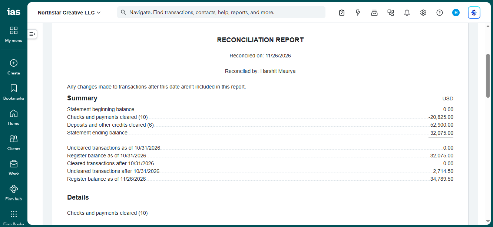
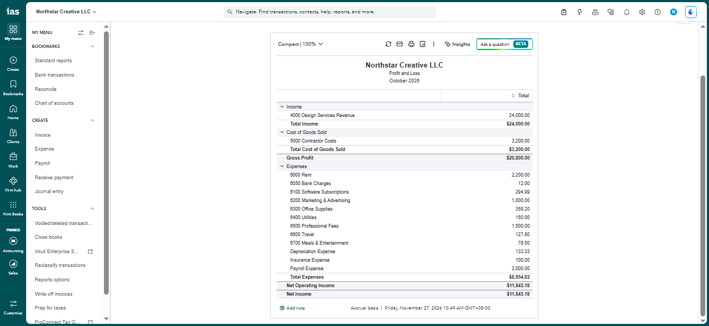
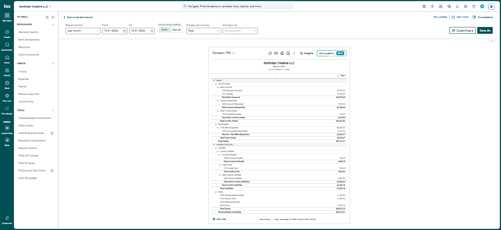
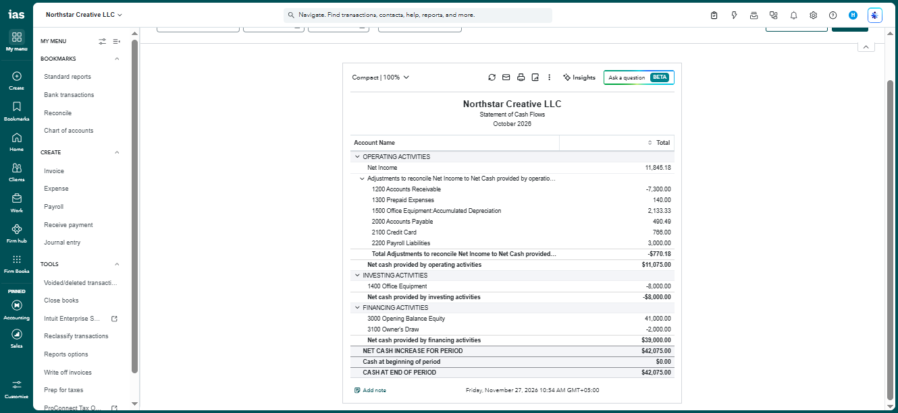

# Northstar Creative LLC — Full-Cycle Month-End Close (October 2026)

## What This Is
A complete bookkeeping cycle for a fictional US creative agency,
built in QuickBooks Online. Demonstrates:

- Chart of Accounts setup (US GAAP structure, 25 accounts)
- 30 days of transaction recording (invoices, bills, expenses, deposits)
- Bank reconciliation (with timing differences, bank error, NSF check)
- Month-end adjusting entries (depreciation, accruals, prepaids)
- Full financial statement generation (P&L, BS, CF, AR/AP Aging)

## Company Profile
- **Entity:** Northstar Creative LLC (Professional Services)
- **Location:** Birmingham, Alabama, 35203-3161
- **Accounting Method:** Accrual (US GAAP)
- **Fiscal Period:** October 2026

## Key Standards Applied
| Standard | Application |
|----------|-------------|
| ASC 606 (Revenue) | Revenue recognized when service delivered (milestone billing) |
| ASC 360 (Depreciation) | Straight-line, 5-yr life, no salvage |
| Matching Principle | Accrued wages, prepaid amortization |
| Revenue Recognition | 60% upfront billing ≠ 60% revenue recognition |

## How to Replicate
1. Sign up for QuickBooks Online free trial (US)
2. Create company: "Northstar Creative LLC", Professional Services, Accrual
3. Build the 25-account COA (see screenshots/02)
4. Record all transactions (see screenshots/04)
5. Reconcile bank (see screenshots/05 + recon-memo.txt)
6. Post adjusting JEs (see screenshots/06)
7. Generate reports (see screenshots/07–12)

## Author
Harshit Maurya — B.Com (Delhi University)
QuickBooks Online ProAdvisor (in progress)   

## Project Screenshots & Financial Reports

### 1. Bank Reconciliation

### 2. Profit & Loss Statement

### 3. Balance Sheet

### 4. Cash Flow Statement

